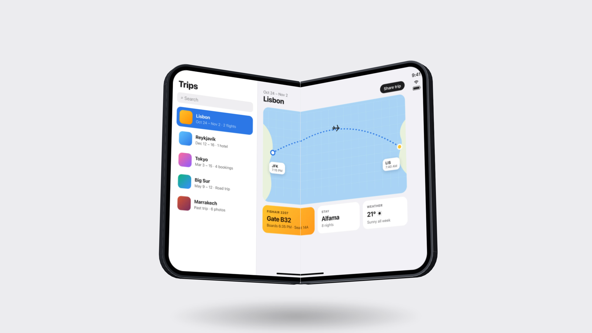

# Unfold

A foldable phone made of HTML and CSS. Put your own screens on it, then open it, close it and turn it around. One file, no dependencies.



## Use it

Copy `unfold.js` into your project and load it as a module.

```html
<script type="module" src="unfold.js"></script>

<unfold-device
  inner="open.png"
  cover="closed.png"
  fold="0"
  interactive>
</unfold-device>
```

Every method returns a promise, so steps can run one after another.

```js
const phone = document.querySelector('unfold-device');

await phone.open();
await phone.animateTo({ yaw: 160, pitch: 14 }, { duration: 1200 });
await phone.close();
```

To see the demo page, serve this folder and open it:

```sh
python3 -m http.server 5190
# then open http://localhost:5190
```

## Attributes

| Name | Values | What it does |
| --- | --- | --- |
| `fold` | 0 to 180 | How far it is open. 0 is shut, 180 is flat. Default 180. |
| `yaw` | degrees | Turns it left or right. Default -18. |
| `pitch` | -90 to 90 | Tips the top towards you or away. Default 8. |
| `roll` | degrees | Rotates it flat on the page. Default 0. |
| `inner` | URL | Image or video on the big inside screen. |
| `cover` | URL | Image or video on the outside screen. |
| `front` | URL | Image or video on the screen of the regular phone. |
| `model` | `foldable`, `bar` | Which phone. `bar` is a regular one-piece phone. |
| `finish` | `black`, `silver` | The colour of the metal and the back. |
| `orientation` | `landscape`, `portrait` | In portrait the phone turns on its side as it opens, so the inside screen stands upright. |
| `interactive` | present or not | Drag to turn, click to flip, arrow keys to turn, F to fold. |
| `click` | `flip`, `fold`, `none` | What a click does when it is interactive. Default `flip`. |
| `zoom` | number | Scales the phone within the element. Default 1. |
| `shadow` | `none` | Hides the shadow underneath. |
| `label` | text | What screen readers call it. Default "Foldable phone". |

Screens take images or videos. Videos play muted and loop, and the two halves of the inner screen stay in sync.

## Methods and properties

| Name | What it does |
| --- | --- |
| `open(options)` | Unfolds it flat. |
| `close(options)` | Folds it shut. |
| `toggle(options)` | Opens it if it is mostly closed, closes it otherwise. |
| `flip(options)` | Turns it around to show the other side. |
| `spin(turns, options)` | Spins it one full turn, or `turns` turns. Negative spins the other way. |
| `animateTo(target, options)` | Animates any of `fold`, `yaw`, `pitch` and `roll`. Options are `duration` in ms, `easing` (a CSS easing name or `cubic-bezier()`) and `delay`. Resolves `true` when it finishes, or `false` if something else moved it first. |
| `stop()` | Stops every animation where it is. |
| `setScreen(name, src)` | Puts a URL, File or Blob on `inner`, `cover` or `front`. Handy for a file picker or a drop. `null` clears it. |
| `fold`, `yaw`, `pitch`, `roll` | Read or set the pose right away, with no animation. |
| `state` | The current pose as one object. |

Animations respect `prefers-reduced-motion`: they jump straight to the end unless you pass `force: true`.

## Events

| Name | When |
| --- | --- |
| `change` | Every time it moves. `event.detail` is the pose: `{ fold, yaw, pitch, roll }`. |
| `activate` | On a click, Enter or Space when it is interactive. `event.detail.action` says what it did. |

## Styling

The element is a block, 16:10 by default. Give it any width and height and the phone scales to fit.

| Name | What it does |
| --- | --- |
| `--unfold-metal` | Colour of the frame. Overrides the finish. |
| `--unfold-back` | Colour of the back glass. |
| `--unfold-plateau` | Colour of the camera bump. |
| `--unfold-shadow` | How dark the shadow is, 0 to 1. Default 0.3. |
| `::part()` | `stage`, `shadow`, `screen`, `back-glass` and `camera`. |

## Your own phone

Models and finishes are plain objects, measured in millimetres. See `MODELS` in `unfold.js` for every field. Add one, then use it by name; phones already on the page that asked for it redraw.

```js
import { MODELS, addModel, addFinish } from './unfold.js';

addFinish('blue', { metal: '#3d4b63', back: '#2b3547', plateau: '#232b39' });
addModel('compact', { ...MODELS.bar, width: 67.6, height: 139.6 });
```

```html
<unfold-device model="compact" finish="blue" front="home.png"></unfold-device>
```

A model with `foldable: true` is built as two halves on a hinge, like the built-in `foldable`.

## How it works

Every part of the phone is a plain element with a CSS 3D transform: two faces and a wall of thin strips for each half, a curved spine, buttons, the camera bump. The transforms are worked out in JavaScript whenever the pose changes. All the pieces sit side by side in one 3D container rather than nested by half, because Safari stops drawing the children of a 3D container once it turns edge-on.

Faces that point away from the viewer are hidden by hand, using the real eye position, instead of with `backface-visibility`. The metal is shaded from a fixed light each frame, and a soft glare slides across the glass as it turns.

The foldable is built to the published size of a book-style foldable: 164.6 by 117.8 mm open, 84.1 by 117.8 mm closed and 11.3 mm thick. It is a likeness, not an official model.

## Browsers

Tested in current Chrome and Safari, on desktop and on phones. On a touchscreen a sideways drag turns it and a vertical swipe still scrolls the page.

## License

MIT. Not affiliated with any phone maker.
